

# 🤖 Diffusion Policy for Push-T
### A from-scratch PyTorch reimplementation: state-based and image-based, with results, ablations and videos

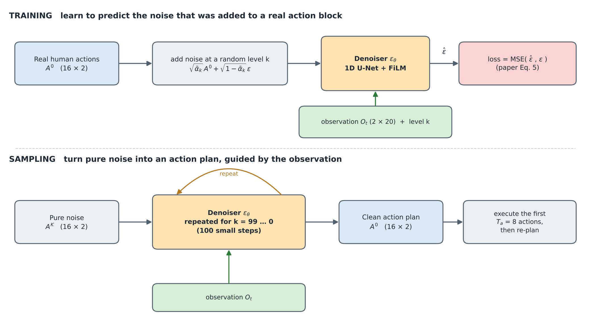

This repository reimplements the **Push-T** experiments of
[*Diffusion Policy: Visuomotor Policy Learning via Action Diffusion*](https://diffusion-policy.cs.columbia.edu/)
(Chi et al.) in plain PyTorch, in one Jupyter notebook. Both variants from the paper are implemented: a
**state-based** policy (observation = 20 numbers) and an **image-based** policy (observation = two camera
frames, encoded by a ResNet-18 with spatial softmax). Both share the same diffusion core and 1D U-Net.

## ✨ TL;DR

| Policy | Training | Mean score, 50 unseen test seeds | Mean score, 6 training seeds |
|---|---|---|---|
| **State-based** | 4500 epochs (A100 + T4) | **0.951** (avg of last 10 checkpoints; std 0.005; best 0.966) | 0.998 |
| **Image-based** | **300 epochs** of a planned 800-epoch schedule (GPU quota ran out) | **0.987** (epoch 300) / 0.981 (epoch 250) | 0.990 / 0.993 |
| Paper, Table 1 (state) | 5000 epochs | 0.95 best / 0.91 avg of last 10 | n/a |
| Paper, Table 2 (image) | 3050 epochs | 0.91 best / 0.84 avg of last 10 | n/a |

- Score of an episode = maximum over the episode of `clip(coverage / 0.95, 0, 1)` (official protocol).
- Both of my policies land in the range of the paper's numbers. **This is comparable, not a confirmed
  reproduction**: budgets, data (206 vs. the official 90 training episodes), seeds and numbers of runs differ.
  See [Differences from the paper](#-differences-from-the-paper-and-the-official-config) and
  [Limitations](#%EF%B8%8F-limitations-and-honest-caveats).
- The image policy scored higher than the state policy here, the opposite of the paper's ordering. I did not
  test why (see the comparison below), so treat it as an observation, not a finding.

  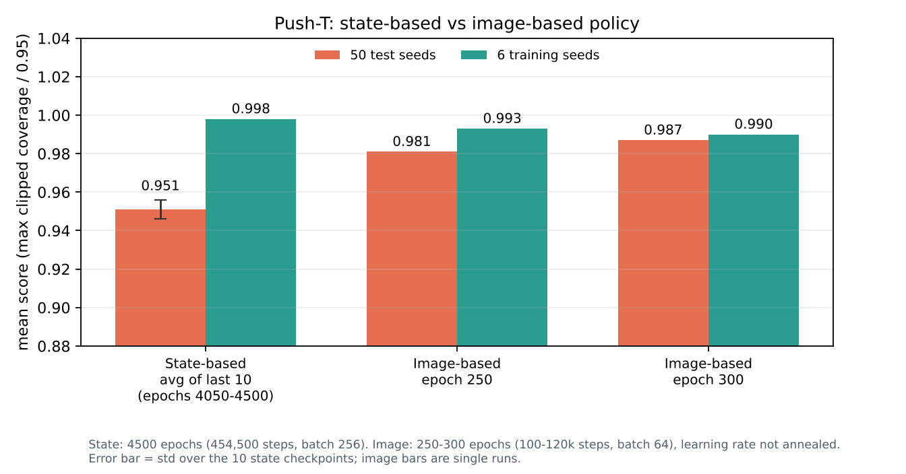

## 📚 Contents
1. [Videos](#-videos)
2. [The task](#-the-task-push-t)
3. [The idea in plain words](#-the-idea-in-plain-words)
4. [Model](#-model)
5. [Training](#%EF%B8%8F-training)
6. [Results](#-results)
7. [Comparison: state vs image](#-comparison-state-vs-image)
8. [Ablations (state-based)](#-ablations-state-based)
9. [Sanity checks](#-sanity-checks-i-ran)
10. [Differences from the paper and the official config](#-differences-from-the-paper-and-the-official-config)
11. [Limitations and honest caveats](#%EF%B8%8F-limitations-and-honest-caveats)
12. [Running it](#%EF%B8%8F-running-it)
13. [Credits and reference](#-credits-and-reference)

## 🎬 Videos
Side by side, **left: state-based policy (epoch 4500), right: image-based policy (epoch 300)**, same
simulator seed. The header shows the best score so far and SUCCESS once coverage passes 95%.

| Seed | State-based | Image-based | What to look at |
|---|---|---|---|
| 100000 | score 1.00, done in 145 steps | score 0.97, used all 300 steps | both reach the target; the image policy ends just below the 95% threshold |
| 100001 | score 1.00, 159 steps | score 1.00, 182 steps | both succeed |
| 100003 | score 0.18, used all 300 steps | score 1.00, 118 steps | a seed where the state policy fails and the image policy succeeds |

  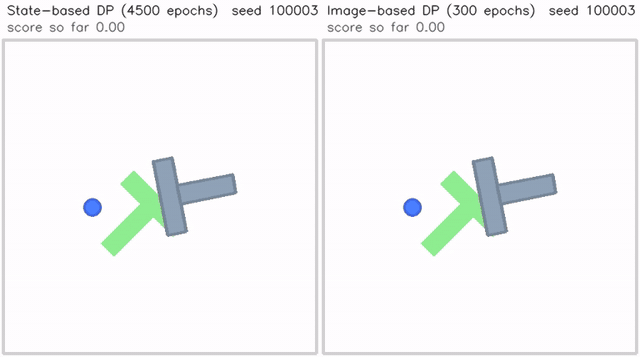 
  <em>Seed 100003: the state policy (left) fails, the image policy (right) succeeds in 118 steps.</em>

  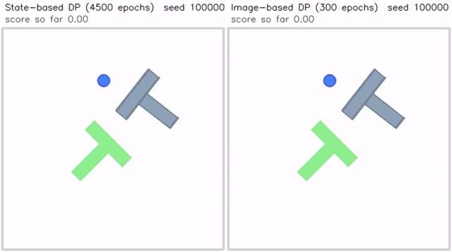 
  <em>Seed 100000: both reach the target; the image policy ends just below the success threshold.</em>

  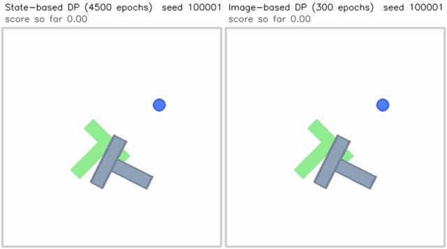 
  <em>Seed 100001: both succeed.</em>

Full-quality mp4 files:
[seed 100000](assets/videos/pusht_seed100000_state_vs_image.mp4),
[seed 100001](assets/videos/pusht_seed100001_state_vs_image.mp4),
[seed 100003](assets/videos/pusht_seed100003_state_vs_image.mp4).

The videos are separate rollouts with fresh sampling noise, so a seed's score in a video can differ from its
score in the 50-seed evaluation (diffusion sampling is stochastic). They are rendered in a twin large-render
environment with the action marker disabled (the official environment draws it at the wrong place) and my own
red target marker.

## 🎯 The task: Push-T
A circular pusher (blue) must push a T-shaped block (gray) onto a fixed target T. Only point contact is
available, so the block is under-actuated and the task needs precise, contact-rich planning. Success is
measured by how much of the target area the block covers.

- **Data:** the human demonstrations released with the paper: **206 episodes, 25,650 steps**.
- **State-based observation (20 numbers):** 9 keypoints on the block (x, y each) + the pusher's position.
- **Image-based observation:** 96 × 96 RGB frame + the pusher's position.
- **Action (2 numbers):** the pusher's **target position** (position control).

  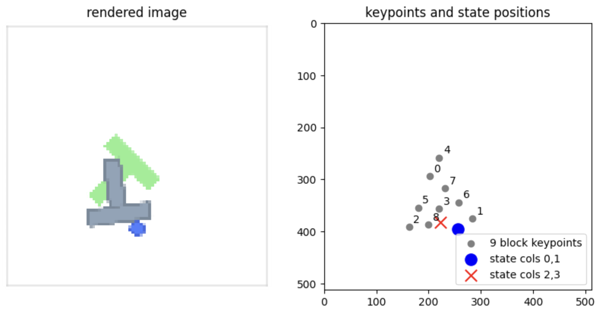 
  <em>One time step: the rendered image (left) and the state-based observation (right).</em>

  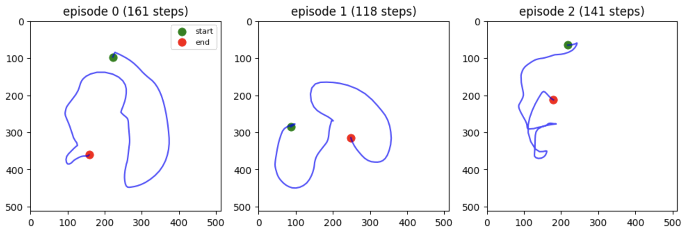 
  <em>The pusher's path in three human demonstrations (green = start, red = end).</em>

  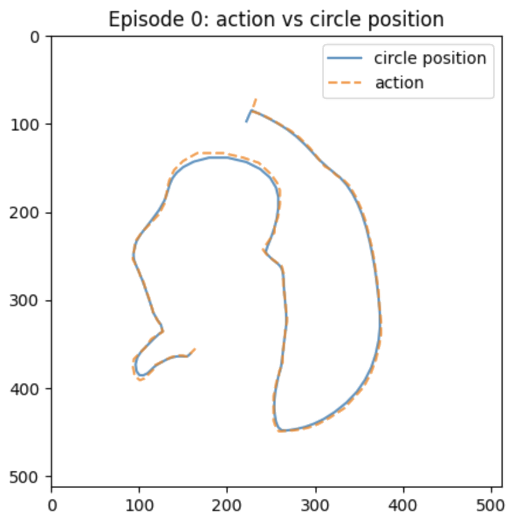 
  <em>Position control: the action (dashed) runs just ahead of the pusher's position (solid).</em>

## 💡 The idea in plain words
A **policy** maps what the robot observes to what it should do. Instead of regressing a single action, a
**diffusion policy** generates a whole **sequence of 16 future actions** by *denoising*:

- **Training:** take a real human action block, add random noise at a random level, and train a network to
  predict the noise that was added (paper Eq. 5). The observation is given to the network as a guide.
- **Sampling:** start from pure noise and apply the network 100 times, each time removing a little noise,
  until a clean action plan remains. Different random starts can end in different valid plans, which is how a
  diffusion policy copes with tasks where several strategies work (going around the block on the left or on
  the right).
- **Receding horizon:** execute only the first part of the plan (8 of the 16 actions), then re-plan.

<b>Why not just regress the action?</b>

If half of the demonstrations go left and half go right, a regression network trained with MSE learns the
*average* (straight ahead), which is wrong in every demonstration. A generative model represents both options
and commits to one. The paper also argues that learning the score (the slope of the log probability) avoids
the intractable normalisation constant that makes energy-based policies unstable to train.

  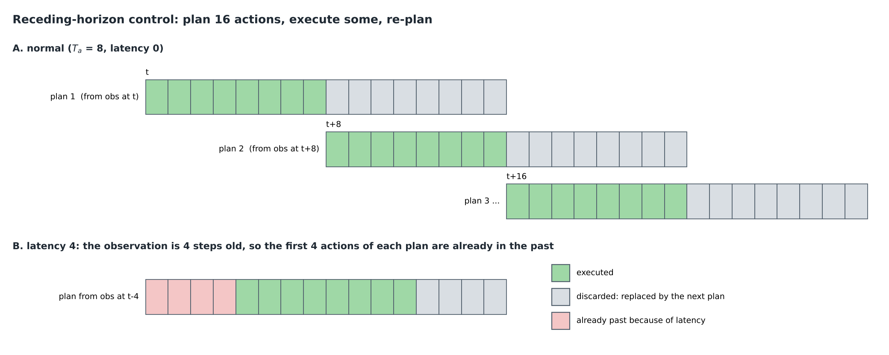

## 🧩 Model

### Shared diffusion core
- **Windows:** T_o = 2 observation steps in, T_p = 16 action steps out, T_a = 8 executed per plan. Windows near
  the start or end of an episode are padded by repeating the first or last row.
- **Normalisation** of observations and actions to [-1, 1] (paper App. A.1).
- **Diffusion:** 100 steps, squared-cosine schedule (iDDPM), noise (epsilon) prediction, MSE loss, DDPM
  sampler with fixed variance and clipping of the predicted clean sample.

  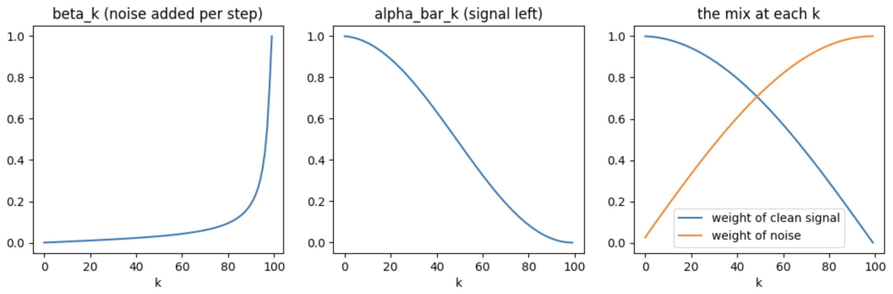

  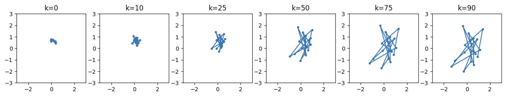 
  <em>Forward noising: a smooth action path dissolves into a cloud of random points.</em>

### Denoising network: conditional 1D U-Net with FiLM
The condition (a sinusoidal embedding of the noise level, through a small MLP, joined with the flattened
observation) enters every residual block through **FiLM**: `scale * features + shift`. GroupNorm throughout,
kernel size 5.

  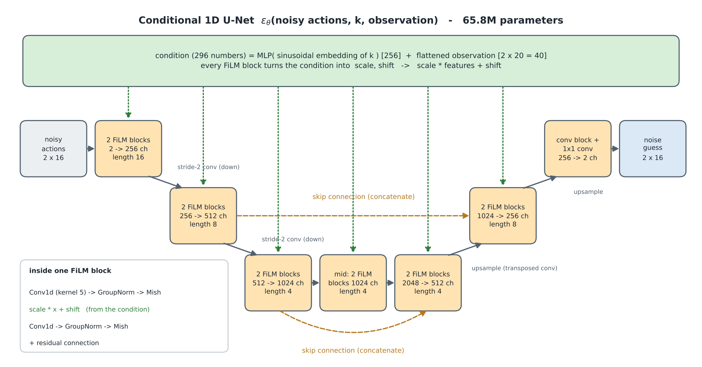

  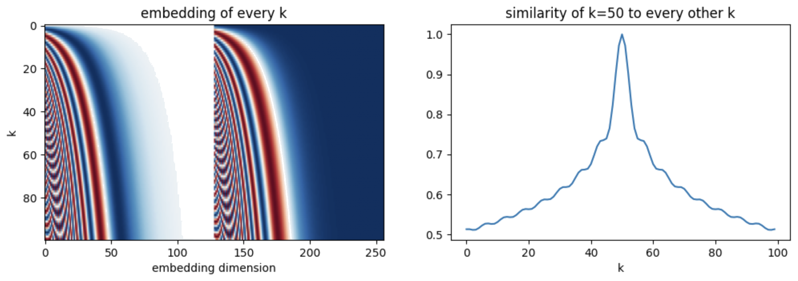

### State-based vs image-based observation path
The only change for the image policy is how the guide vector is produced (paper §3.2): a **ResNet-18 trained
from scratch** (GroupNorm instead of BatchNorm, because BatchNorm and EMA interact badly), whose global
average pooling is replaced by **spatial softmax** (a 1×1 convolution to 32 keypoint maps, then the expected
(x, y) of each map), so each frame yields 64 numbers. With the pusher position that is 66 numbers per frame,
132 for 2 frames. Training uses a random 84×84 crop of the 96×96 frame, evaluation a center crop. The encoder
is trained end to end, and at inference the picture is encoded once per plan.

  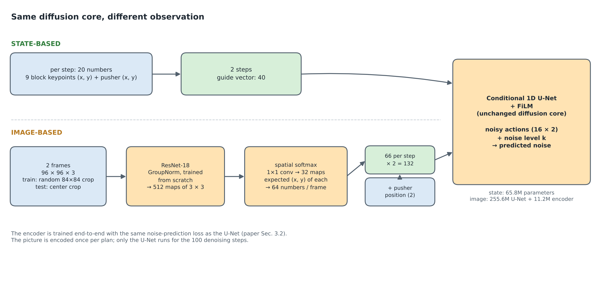

| | State-based | Image-based |
|---|---|---|
| U-Net channels | 256 / 512 / 1024 | 512 / 1024 / 2048 |
| U-Net parameters | 65.8M (whole network) | 255.6M |
| Observation encoder | none (20 numbers per step) | ResNet-18 + spatial softmax, 11.2M |
| Conditioning size | 40 | 132 |
| Batch size | 256 | 64 |

## 🏋️ Training
Noise-prediction MSE (Eq. 5), AdamW, cosine learning-rate schedule with 500 warmup steps, an EMA copy of the
weights used for evaluation, and resumable checkpoints every 50 epochs.

| | State-based | Image-based |
|---|---|---|
| Epochs run | 4500 (454,500 steps) | 300 (≈120k steps) of a planned 800-epoch cosine schedule |
| Why stopped | schedule finished | Colab GPU quota ran out; a replacement T4 would have needed ~35 h more |
| Hardware | T4 (~0.30 s/step), then A100 (epochs 3101 to 4500 took 3.12 h) | A100, 0.067 s/step (≈29 s/epoch); T4 gave 1.63 s/step (~10.9 min/epoch) |
| Mean loss, epoch 1 → last | 0.308 → 0.00014 (epoch 4500) | 0.201 → 0.0087 (epoch 300) |
| LR schedule | completed (annealed to ~0) | **cut at 300 of 800 epochs, so the learning rate was never annealed** |

  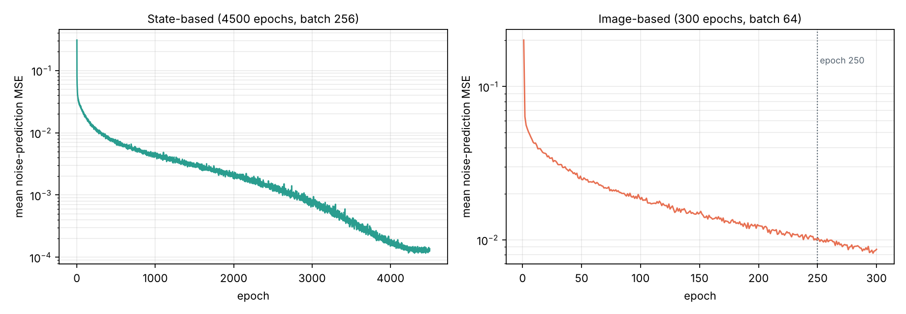

| Mean training loss at epoch | 1 | 10 | 100 | 300 | 1000 | 3000 | 4500 |
|---|---|---|---|---|---|---|---|
| State-based | 0.308 | 0.040 | 0.0188 | 0.0098 | 0.0044 | 0.00078 | 0.00014 |
| Image-based | 0.201 | 0.043 | 0.0184 | 0.0087 | n/a | n/a | n/a |

At equal epochs the two runs have similar loss (about 0.0098 vs 0.0087 at epoch 300), although the image run
uses batch 64 instead of 256. The state loss keeps falling by more than an order of magnitude after epoch
1000 while the test score stays flat around 0.95 (last-10 table below); the training loss is therefore not a
good predictor of rollout quality here.

Because the image run stopped early, its weights come from the middle of a cosine schedule. That is a
disadvantage for it (an annealed run would probably be better), not an advantage.

## 📈 Results

### Evaluation protocol (follows the official evaluation code)
Receding-horizon control with 2 observation steps in and 8 actions executed per 16-step plan; at most 300
steps per episode, stopping early above 95% coverage. Episode score = maximum over the episode of
`clip(coverage / 0.95, 0, 1)`. **50 test seeds (100000 to 100049)** and **6 training seeds (0 to 5)**. Weights
are the EMA weights. All environments are stepped in lockstep in batches.

### State-based: last 10 checkpoints

  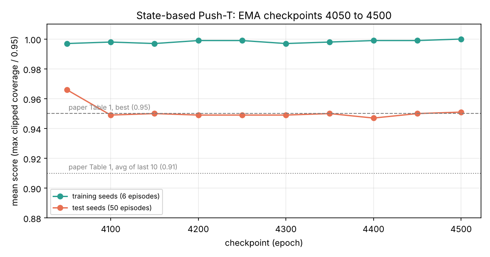

| Epoch | 4050 | 4100 | 4150 | 4200 | 4250 | 4300 | 4350 | 4400 | 4450 | 4500 |
|---|---|---|---|---|---|---|---|---|---|---|
| Test (50 seeds) | 0.966 | 0.949 | 0.950 | 0.949 | 0.949 | 0.949 | 0.950 | 0.947 | 0.950 | 0.951 |
| Train (6 seeds) | 0.997 | 0.998 | 0.997 | 0.999 | 0.999 | 0.997 | 0.998 | 0.999 | 0.999 | 1.000 |

Average of the 10 checkpoints: **test 0.951 (std 0.005, max 0.966), train 0.998**. An earlier separate
evaluation of the epoch-4500 checkpoint gave 0.948 (test) and 0.994 (train); the small difference to the
table (0.951 / 1.000) is sampling noise.

### Image-based
| Checkpoint | Test (50 seeds) | Train (6 seeds) |
|---|---|---|
| Epoch 250 | 0.981 | 0.993 |
| Epoch 300 | **0.987** | 0.990 |

### Against the paper
| | This repo | Paper |
|---|---|---|
| State-based, avg of last 10 / best | 0.951 / 0.966 | 0.91 / 0.95 (Table 1, CNN) |
| Image-based | 0.987 (single checkpoint, epoch 300) | 0.84 avg / 0.91 best (Table 2, CNN) |

I do not claim to beat the paper: my "best" is chosen on the same test seeds I report on, my image number is
a single checkpoint rather than an average, and the training sets and budgets differ.

## 🔬 Comparison: state vs image

  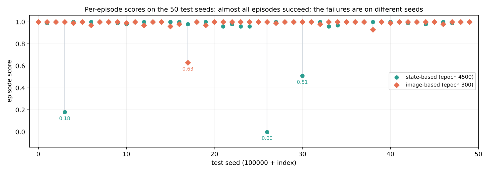

- Almost every episode succeeds with both policies (score 0.93 to 1.0). The mean difference comes from a few
  failures: the state policy failed on test seeds **100003 (0.18), 100026 (0.00), 100030 (0.51)**; the image
  policy had one clear failure, **100017 (0.63)**. The failures are on *different* seeds, so they look like
  policy-level planning errors rather than "hard scenes".
- With 50 episodes, a single 0.0 episode moves the mean by 0.02. The 0.036 gap in mean test score (0.951 vs
  0.987) is therefore driven by three or four episodes. I would not read it as a robust ranking.
- Possible reasons for image ≥ state (all **untested** hypotheses): the roughly 4× larger U-Net (255.6M vs
  65.8M); different batch size and optimizer betas; random-crop augmentation acting as a regulariser; the
  state number being a last-10 average while the image number is one checkpoint reported after seeing
  results; plain seed noise. The paper reports the opposite ordering, so a controlled comparison (same
  U-Net, several training seeds) would be needed to say anything beyond "both work".
- Train-vs-test gap: 0.998 vs 0.951 for the state policy, 0.990 vs 0.987 for the image policy. With 6
  training seeds that gap is also noisy.

## 🧪 Ablations (state-based)
All on the epoch-4500 EMA state-based model, 50 test seeds, **3 sampling seeds each**; dots are single runs,
the line is the mean.

  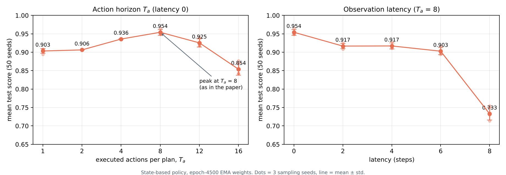

| Executed actions per plan, T_a | 1 | 2 | 4 | **8** | 12 | 16 |
|---|---|---|---|---|---|---|
| Mean score | 0.903 | 0.906 | 0.936 | **0.954** | 0.925 | 0.854 |

| Observation latency (steps, T_a = 8) | 0 | 2 | 4 | 6 | 8 |
|---|---|---|---|---|---|
| Mean score | 0.954 | 0.917 | 0.917 | 0.903 | 0.733 |

**Action horizon.** An intermediate T_a = 8 is best, matching the paper's choice. Re-planning at every step
(T_a = 1) is worse, possibly because consecutive plans can commit to different modes and the pusher dithers;
executing the full plan (T_a = 16) is worse as well, plausibly because the policy cannot react in the
meantime. These explanations are interpretations; I did not test them directly.

**Latency.** I simulate latency by giving the policy an observation window that ends `latency` steps in the
past and executing plan rows `[latency : latency + 8]`. The score drops by about 0.04 at latency 2, stays
roughly flat to 6, and collapses at 8 (0.733). The paper reports a flat region up to about 4 steps; mine drops
sooner, so this is only a partial match.

**Raw vs EMA weights.** At epoch 4500 the cosine learning rate is about zero, so raw and EMA weights are almost
identical and scored about the same (mean of 3 runs: raw 0.953, EMA 0.954). That does **not** show that EMA is unnecessary: its value is during
training, and I did not evaluate raw vs EMA mid-training.

## ✅ Sanity checks I ran

| Check | Result |
|---|---|
| Dataset size | 206 episodes, 25,650 steps, mean length 124.5 (min 49, max 246) |
| Actions are positions | median distance between the action and the pusher's position is 19.3 on a 0 to 512 field |
| Normalisation | min = -1, max = +1 exactly; round-trip error at most 3e-5 |
| Training windows | shapes (2, 20) and (16, 2); padding at episode start and end behaves as intended |
| Recovering the clean action from the *true* noise | error around 1e-7 for k = 10, 50, 90 |
| Effect of a slightly wrong noise guess (error scale 0.1) | recovery error grows with k: 0.042 (k = 10), 0.348 (k = 50), 1.41 (k = 90) |
| State network | 65,783,298 parameters; output shape (batch, 16, 2); depends on both the observation and k |
| Image pipeline | simulator frames and dataset frames have matching pixel ranges (min about 0.25, max 1.0); a smoke evaluation of an early image checkpoint on 10 seeds scored 0.856, confirming the pipeline runs end to end |
| Sampler | 8 samples per observation after only 200 training steps already lie near the human action (below) |

  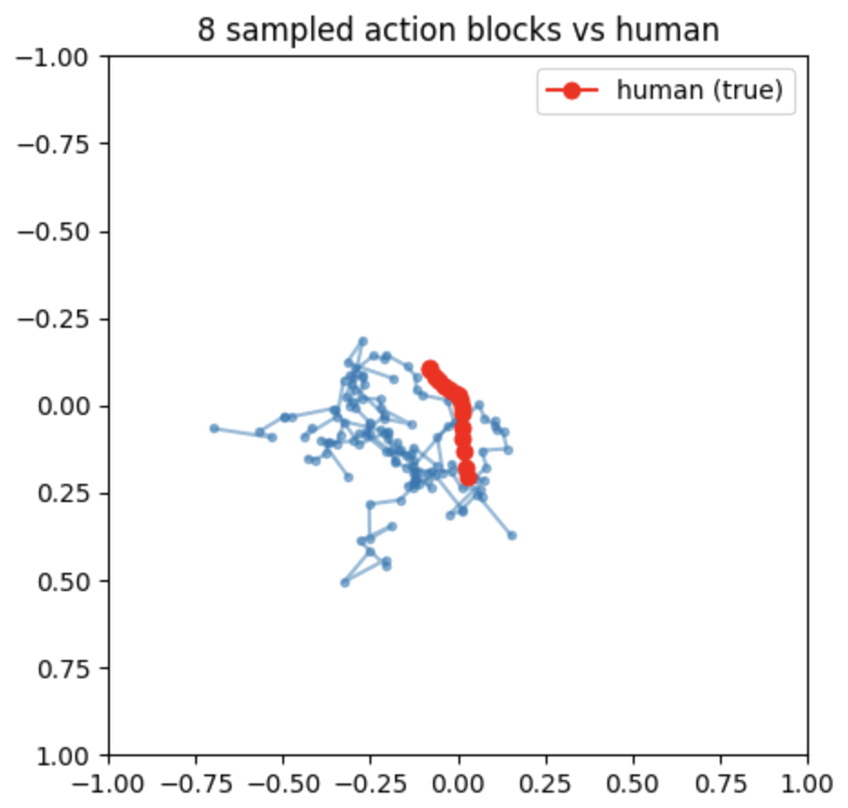

## 🔁 Differences from the paper and the official config
I checked these against the official repository's configs.

| | This repo | Official / paper |
|---|---|---|
| State U-Net channels | 256 / 512 / 1024 (65.8M) | **same** as the official low-dim config |
| Image U-Net channels | 512 / 1024 / 2048 (255.6M) | same; this is the paper's ~256M network |
| Epochs | state 4500, image 300 (of 800 planned) | state 5000, image 3050 |
| Training episodes | all 206 | official config caps at 90 |
| AdamW betas | 0.9 / 0.999 (state), 0.95 / 0.999 (image) | 0.95 / 0.999 |
| Batch size | state 256, image 64 | state 256, image 64 |
| EMA | ramp towards 0.9999, my warmup | power 0.75 (2/3) schedule, max 0.9999 |
| Variance | fixed (DDPM) | fixed (DDPM); iDDPM learned variances are not used |
| Spatial-softmax keypoints | 32 | not verified |
| Vision encoder size | 11.2M | the paper lists about 22M; I did not find the reason |

(An earlier version of this README called my 65.8M state network a "smaller variant" of the paper's. That was
wrong: the official low-dim config uses the same channels; the 256M figure belongs to the image configuration.)

## ⚠️ Limitations and honest caveats
- **Single training run per policy.** The std quoted for the state policy is over checkpoints of one run (they
  are nearly identical models), not over independent trainings. The image result is one checkpoint.
- **Image run is short and was never annealed.** It saw about 10% of the paper's image schedule.
- **No image ablations.** All ablations are state-based.
- **Selection on test seeds.** "Best checkpoint" and "epoch 300" were reported after looking at test seeds, so
  the averages are the more honest numbers.
- **Small evaluation sets.** 50 test seeds; one failure changes the mean by about 0.02.
- **Different data and seeds from the paper.** I trained on 206 episodes, the official config on 90, and the
  official runner's comments say the paper used a slightly different seed selection.
- **Videos are single stochastic rollouts** and are illustrations, not statistics.

Ideas for future work: several training seeds, the full 3050-epoch image schedule, image-based ablations,
EMA vs raw during training, and an observation-horizon ablation.

## ▶️ Running it
1. Download the Push-T data (`pusht.zip`) from the [project page](https://diffusion-policy.cs.columbia.edu/)
   and unzip it so that `data/pusht/pusht_cchi_v7_replay.zarr` exists.
2. `pip install -r requirements.txt` (`pymunk==6.6.0` is needed by the simulator).
3. Open `notebooks/pusht_diffusion_policy.ipynb` and run the cells in order. A GPU is strongly recommended
   (the image phase needs an A100-class GPU for reasonable speed). Paths in the notebook point to Google Drive
   on Colab; adjust the data and checkpoint paths for your machine. The simulator is cloned from the authors'
   [official repository](https://github.com/real-stanford/diffusion_policy) inside the notebook.
4. Notebook map: state pipeline (data, schedule, U-Net, training) → simulator and evaluation → ablations →
   image pipeline (dataset, encoder, training, evaluation) → side-by-side videos. A few cells carry notes
   where an old output was cleared (an interrupted launch, a notebook restart).

## 📖 Credits and reference
- The Push-T simulator, dataset and reference configs come from the authors' official
  [implementation](https://github.com/real-stanford/diffusion_policy). The policy, training, evaluation loop,
  ablations and figures in this repository are my own.
- Cheng Chi, Zhenjia Xu, Siyuan Feng, Eric Cousineau, Yilun Du, Benjamin Burchfiel, Russ Tedrake, Shuran Song.
  *Diffusion Policy: Visuomotor Policy Learning via Action Diffusion.* arXiv:2303.04137 (RSS 2023; IJRR 2024).
  https://diffusion-policy.cs.columbia.edu/
